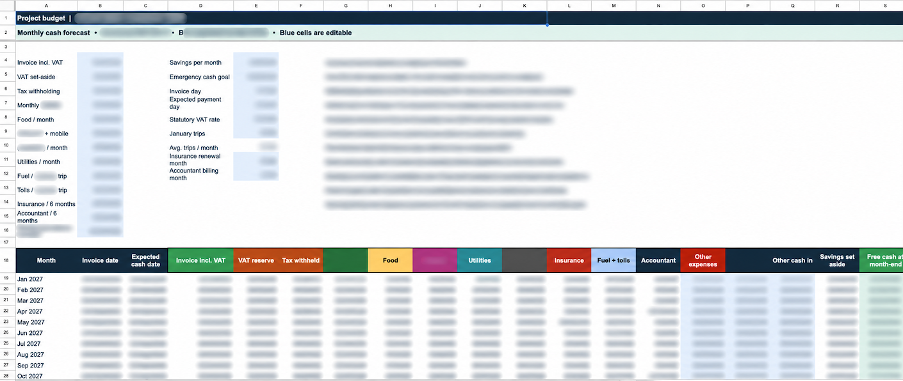

# Bot οικονομικών για Telegram

[English guide](README.md)

Καταχώρισε έξοδα, έσοδα, αποπληρωμές και αποταμιεύσεις από ιδιωτική συνομιλία στο Telegram. Ο bot ενημερώνει το Google Sheet, διαβάζει ξανά κάθε καταχώριση και στέλνει επιβεβαίωση στα ελληνικά με εντολή αναίρεσης. Το Google Apps Script ελέγχει για μηνύματα περίπου κάθε λεπτό, ακόμη κι όταν ο υπολογιστής σου είναι κλειστός.

## 1. Προετοίμασε το Google Sheet

Χρησιμοποίησε το υπάρχον φύλλο προϋπολογισμού σου σε μορφή Google Sheets. Αν το έχεις σε Excel, ανέβασέ το στο Drive, άνοιξέ το και επίλεξε **Αρχείο → Αποθήκευση ως Υπολογιστικά φύλλα Google**. Ο κώδικας χρησιμοποιεί τις παρακάτω καρτέλες και κελιά:

| Καρτέλα | Κελιά | Χρήση |
| --- | --- | --- |
| `Cash baseline` | `B4`, `A10` | Αρχικά διαθέσιμα και ημερομηνία έναρξης των κινήσεων |
| `24-month plan` | `A19:A42` | Η πρώτη ημέρα κάθε μήνα του πλάνου |
| `24-month plan` | `B8`, `H19:H42` | Ποσό για φαγητό πριν από το πλάνο και για κάθε μήνα του πλάνου |
| `24-month plan` | `H19:O42` | Μηνιαία έξοδα διαβίωσης, με το φαγητό στη στήλη H |

Αν ξεκινάς από κενό Google Sheet, δημιούργησε τις δύο καρτέλες και συμπλήρωσε τα κελιά του πίνακα. Βάλε ημερομηνίες στα `A10` και `A19:A42`. Ξεκίνα το πλάνο την πρώτη ημέρα ενός μήνα. Στο `A20` βάλε `=EDATE(A19,1)` και τράβηξε τον τύπο μέχρι το `A42`. Αν το φύλλο χρησιμοποιεί `;` ως διαχωριστικό ορισμάτων, χρησιμοποίησε `=EDATE(A19;1)`. Για σταθερό μηνιαίο ποσό φαγητού βάλε `=$B$8` στη στήλη H. Αν θέλεις να εμφανίζονται οι δύο μήνες πριν από το πλάνο, βάλε ημερομηνία έναρξης μέσα σε αυτό το διάστημα. Ρύθμισε τη ζώνη ώρας του φύλλου για τις ημερομηνίες των καταχωρίσεων. Βάλε τα δικά σου ποσά προϋπολογισμού στο φύλλο.

## 2. Δημιούργησε έναν bot στο Telegram

1. Άνοιξε τον επίσημο [@BotFather](https://t.me/BotFather) στο Telegram και στείλε `/newbot`.
2. Ακολούθησε τα βήματα για το εμφανιζόμενο όνομα και το username.
3. Αντέγραψε το token για το επόμενο βήμα. Κράτησέ το ιδιωτικό.

## 3. Εγκατάστησε τον κώδικα

1. Στο Google Sheet επίλεξε **Επεκτάσεις → Apps Script**.
2. Αντικατάστησε τον αρχικό κώδικα με το [mpatzetBot.gs](mpatzetBot.gs) και αποθήκευσε.
3. Στο Apps Script πήγαινε **Project Settings → Script properties** και πρόσθεσε:

   | Ιδιότητα | Τιμή |
   | --- | --- |
   | `TELEGRAM_BOT_TOKEN` | Το token από τον BotFather |
   | `PAIR_CODE` | Έναν τυχαίο κωδικό τουλάχιστον 16 γραμμάτων ή ψηφίων |
   | `SUBSCRIPTION_KEYWORDS` | Προαιρετικό. Ονόματα ή φράσεις χωρισμένα με κόμμα που αναγνωρίζονται ως συνδρομές. Παράδειγμα `Μουσική Δείγμα, Ταινίες Δείγμα`. |
   | `GEMINI_API_KEY` | Προαιρετικό. Πρόσθεσε το κλειδί Gemini για τις λειτουργίες AI. |

4. Στον επεξεργαστή διάλεξε **installBudgetBot**, πάτησε **Run** και δώσε τα δικαιώματα από τον λογαριασμό Google που έχει το φύλλο. Η εγκατάσταση δημιουργεί τις καρτέλες **Telegram transactions** και **Actuals vs plan**, μαζί με τον αυτόματο έλεγχο μηνυμάτων.
5. Στείλε `/pair YOUR_CODE` σε **ιδιωτική συνομιλία** με τον bot, χρησιμοποιώντας τον δικό σου κωδικό. Περίμενε να απαντήσει **Paired**. Με την επιτυχημένη σύνδεση εμφανίζεται το `OWNER_ID` και διαγράφεται ο κωδικός `PAIR_CODE`.
6. Στείλε `Διόδια 6,40 ευρώ` για δοκιμή. Θα πρέπει να δεις την απάντηση **«Αποθήκευσα τα έξοδα για διόδια με αξία 6,40€.»** και τη νέα γραμμή στο **Telegram transactions**. Χρησιμοποίησε το `/undo` από την απάντηση για να ακυρώσεις τη δοκιμή.

## 4. Χρησιμοποίησε τον bot

| Τι θέλεις να κάνεις | Παράδειγμα |
| --- | --- |
| Να καταχωρίσεις φαγητό ή ποτό | `σάντουιτς 6,50 ευρώ` ή `καφές 3 ευρώ` σε ξεχωριστά μηνύματα |
| Να καταχωρίσεις συνδρομή | `Συνδρομή 9,50 ευρώ` |
| Να καταχωρίσεις λογαριασμό τηλεπικοινωνιών | `Πλήρωσα 28 ευρώ για ίντερνετ` |
| Να καταχωρίσεις ασφάλιση εργασίας | `Πλήρωσα 85 ευρώ για ασφάλιση εργασίας` |
| Να καταχωρίσεις αμοιβή | `Έλαβα 250 ευρώ για τιμολόγιο` |
| Να καταχωρίσεις εξόφληση κάρτας | `Πλήρωσα 40 ευρώ στην πιστωτική κάρτα` |
| Να βάλεις ή να βγάλεις χρήματα από την αποταμίευση | `/save 80` ή `/withdraw 30` |
| Να βάλεις παλιότερο έξοδο | `Χθες πλήρωσα 18 ευρώ για τρόφιμα` |
| Να δεις πόσα ξόδεψες | `Πόσα ξόδεψα για το αυτοκίνητο τον προηγούμενο μήνα;` |
| Να δεις τι απομένει για φαγητό | `Πόσα μου μένουν για φαγητό αυτόν τον μήνα;` |
| Να ετοιμάσεις πολλές καταχωρίσεις με Gemini | `/ai Χθες έβαλα 20 ευρώ βενζίνη και πλήρωσα 11,50 ευρώ διόδια` |

Τρόφιμα, φαγητό έξω, καφές και ποτά μπαίνουν στον ίδιο μηνιαίο προϋπολογισμό φαγητού. Οι συνηθισμένες αγορές καταχωρίζονται απευθείας. Για άγνωστα είδη μπορεί να επιλέξει κατηγορία το Gemini. Ο κώδικας ελέγχει το ποσό και την ημερομηνία πριν καταχωρίσει αυτόματα μια σαφή αγορά φαγητού. Για προσχέδια χρησιμοποίησε το `/confirm` ή το `/cancel` από την απάντηση. Τα προσχέδια λήγουν σε 15 λεπτά.

Το **Telegram transactions** έχει τις καταχωρίσεις σου. Στο **Actuals vs plan** βλέπεις τα διαθέσιμα μετά τις καταγεγραμμένες κινήσεις, τις αποπληρωμές και τα μηνιαία έξοδα για φαγητό και διαβίωση. Αν γίνει λάθος, ακύρωσε την εγγραφή με `/undo` και στείλε τη διορθωμένη κίνηση. Για πιστωτική κάρτα, καταχώρισε είτε την αγορά είτε την εξόφληση σύμφωνα με το πώς παρακολουθείς τα διαθέσιμά σου, ώστε να μετρήσει μία φορά.

## 5. Πρόσθεσε AI σε υπάρχουσα εγκατάσταση

Αντικατάστησε τον υπάρχοντα κώδικα Apps Script με το [mpatzetBot.gs](mpatzetBot.gs), αποθήκευσε και πρόσθεσε το `GEMINI_API_KEY` στα **Script properties**. Η σύνδεση με το Telegram και ο αυτόματος έλεγχος συνεχίζουν να λειτουργούν. Χρησιμοποιείται το [Gemini 3.1 Flash-Lite](https://aistudio.google.com/docs/models/gemini-3.1-flash-lite). Δες τους [όρους του Gemini API](https://aistudio.google.com/docs/terms) για το έργο και την περιοχή σου.

Στο Gemini στέλνονται το μήνυμα που χρειάζεται ερμηνεία, η τρέχουσα ημερομηνία και οι κανόνες ταξινόμησης. Το Apps Script διαβάζει το φύλλο και κάνει τους υπολογισμούς μέσα στο Google Sheets. Απλές εγγραφές και συνηθισμένες ερωτήσεις εξυπηρετούνται απευθείας. Για να απενεργοποιήσεις το Gemini, αφαίρεσε το `GEMINI_API_KEY`.

## Πώς λειτουργεί η επεξεργασία φυσικής γλώσσας (NLP)

Ο bot μετατρέπει το κείμενο σε πεζά χωρίς τόνους. Έπειτα χρησιμοποιεί κανονικές εκφράσεις για να εντοπίσει την ημερομηνία και το ποσό σε ευρώ και αντιστοιχίζει λέξεις-κλειδιά σε τύπο συναλλαγής και κατηγορία. Για συνδρομές, αναζητά και τις φράσεις που έχεις βάλει στα Script properties. Οι σύντομες ερωτήσεις προϋπολογισμού έχουν δικούς τους κανόνες. Όταν οι κανόνες δεν αρκούν και το Gemini είναι ενεργό, ο bot ζητά δομημένο JSON με προκαθορισμένες κατηγορίες και τύπους ερωτήσεων. Ο κώδικας ελέγχει το αποτέλεσμα πριν καταχωρίσει συναλλαγή ή διαβάσει το φύλλο.

## Αν κάτι δεν λειτουργεί

| Σύμπτωμα | Τι να ελέγξεις |
| --- | --- |
| Ο bot δεν απαντά στη σύνδεση | Στείλε `/pair YOUR_CODE` στην ιδιωτική συνομιλία του bot. Τρέξε μία φορά το **pollBudgetBot** και έλεγξε αν εμφανίστηκε το `OWNER_ID` στα **Script properties**. |
| Εμφανίζεται HTTP 404 με `undefined` | Διάλεξε **pollBudgetBot** από το μενού συναρτήσεων. Η `telegram` είναι βοηθητική συνάρτηση του κώδικα. |
| Απαντά μόνο όταν πατάς Run | Στο **Triggers** έλεγξε ότι υπάρχει το **pollBudgetBot** και στο **Executions** δες αν υπάρχουν σφάλματα. |
| Το Gemini επιστρέφει HTTP 503 | Ο κώδικας κάνει δύο επαναλήψεις. Αν το Gemini παραμένει προσωρινά εκτός λειτουργίας, χρησιμοποίησε μια απλή εγγραφή ή ερώτηση που αναγνωρίζει ο bot απευθείας. |
| Θέλεις να κάνεις παύση | Αφαίρεσε το **pollBudgetBot** από το **Triggers**. Για επανεκκίνηση, τρέξε ξανά το **installBudgetBot**. |

## Κώδικας και δοκιμές

Στο [mpatzetBot.gs](mpatzetBot.gs) βρίσκονται οι συναρτήσεις για την εγκατάσταση, την επικοινωνία με το Telegram, τον έλεγχο των εγγραφών, το Gemini και τις ερωτήσεις προϋπολογισμού. Κάθε συνάρτηση έχει σύντομο σχόλιο που εξηγεί τι κάνει.

Για τοπικές δοκιμές, τρέξε `npm test` από το repo με Node.js 18 ή νεότερο. Τα τεστ προσομοιώνουν Telegram, Apps Script, Google Sheets και Gemini με δοκιμαστικά δεδομένα. Για έλεγχο της πραγματικής εγκατάστασης, στείλε το δοκιμαστικό μήνυμα από το βήμα 3.

[Telegram Bot API](https://core.telegram.org/bots/api) · [Αυτόματοι έλεγχοι του Google Apps Script](https://developers.google.com/apps-script/guides/triggers/installable)
