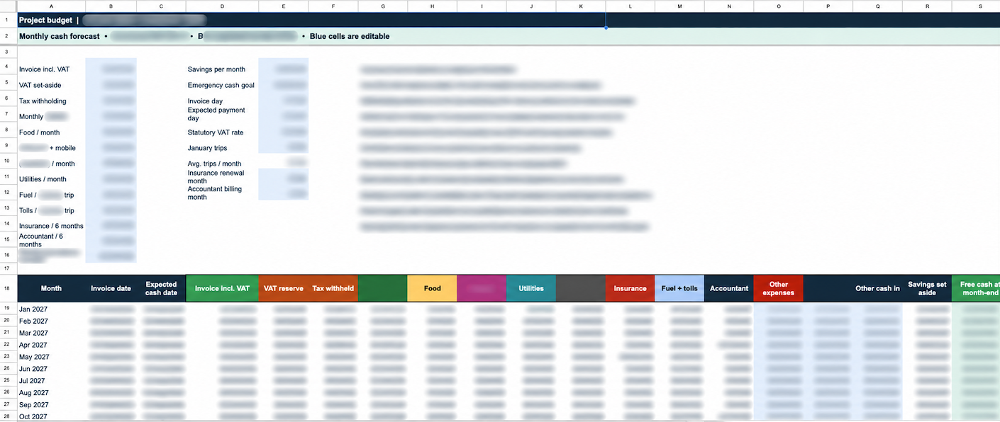

# Telegram Budget Bot

[Greek guide](README.el.md)

Log expenses, income, repayments and savings in a private Telegram chat. The bot records them in Google Sheets, reads each saved entry back, and sends an acknowledgment in Greek with an undo command. Google Apps Script checks Telegram about once a minute, including while your computer is off.

## 1. Prepare the Google Sheet

Use your existing budget in native Google Sheets format. For an Excel copy, upload it to Drive, open it, then select **File → Save as Google Sheets**. The script uses these existing sheet names and cells:

| Sheet | Cells | Purpose |
| --- | --- | --- |
| `Cash baseline` | `B4`, `A10` | Opening cash and the date from which to include transactions |
| `24-month plan` | `A19:A42` | The first date of each forecast month |
| `24-month plan` | `B8`, `H19:H42` | Food budget before the forecast and in each forecast month |
| `24-month plan` | `H19:O42` | Monthly living expenses, including food in column H |

To start from a blank Google Sheet, create the two named tabs and fill those ranges. Enter actual date values in `A10` and `A19:A42`. Start the forecast at the first of a month and fill the next 23 months with `=EDATE(A19,1)` starting in `A20`. Use `=$B$8` in column H for a fixed monthly food budget. Keep the opening date within the two months before the forecast if you want those months in the dashboard. Choose the spreadsheet time zone you want the bot to use for transaction dates. Enter your own budget amounts in the sheet.

## 2. Create a Telegram bot

1. Open the official [@BotFather](https://t.me/BotFather) in Telegram and send `/newbot`.
2. Follow the prompts for the display name and username.
3. Copy the bot token for the next step. Keep it private.

## 3. Install the script

1. In the Google Sheet, select **Extensions → Apps Script**.
2. Replace the starter file with the contents of [mpatzetBot.gs](mpatzetBot.gs) and save.
3. In **Project Settings → Script properties**, add the following properties:

   | Property | Value |
   | --- | --- |
   | `TELEGRAM_BOT_TOKEN` | The token from BotFather |
   | `PAIR_CODE` | A random string of at least 16 letters or digits |
   | `SUBSCRIPTION_KEYWORDS` | Optional. Comma-separated names or phrases that should match the subscription category, such as `Example Stream, Sample Music`. |
   | `GEMINI_API_KEY` | Optional. Add your Gemini API key to enable AI features. |

4. In the Apps Script editor, select **installBudgetBot**, click **Run**, and approve the Google permissions under the account that owns the sheet. The installer creates **Telegram transactions**, **Actuals vs plan**, and a scheduled trigger.
5. Open your bot in a **private chat** and send `/pair YOUR_CODE` using your actual pairing code. Wait for the bot to say **Paired**. Apps Script creates `OWNER_ID` and clears `PAIR_CODE` when pairing succeeds.
6. Send `Tolls 6.40 euros` to test the bot. Check that the receipt and the new row in **Telegram transactions** show the same amount. Use the `/undo` command from the reply to void the test entry.

## 4. Use the bot

| What you want to do | Example |
| --- | --- |
| Record food or a drink | `Sandwich 6.50 euros` or `Coffee 3 euros` as separate messages |
| Record a subscription | `Subscription 9.50 euros` |
| Record a telecommunication bill | `Paid 28 euros for internet` |
| Record work insurance | `Paid 85 euros for work insurance` |
| Record a work payment | `Received 250 euros for an invoice` |
| Record a card repayment | `/repay 40 credit card` |
| Move money into or out of savings | `/save 80` or `/withdraw 30` |
| Enter an earlier expense | `/expense 18 groceries yesterday` |
| Ask what you spent | `/ask How much did I spend on the car last month?` |
| Check what is left for food | `How much do I have left for food this month?` |
| Draft multiple transactions with Gemini | `/ai Yesterday I spent €20 on petrol and €11.50 on tolls` |

Food, takeaway, restaurant meals, coffee and drinks share the monthly food budget. Common entries post directly. For unfamiliar food purchases, Gemini can choose the category, and the script checks the amount and date before posting a clear single entry. For a draft, use the `/confirm` or `/cancel` command the bot sends. Drafts expire after 15 minutes.

The ledger stores completed transactions. **Actuals vs plan** shows cash after logged moves, repayments, and monthly food and living expenses. If you made a mistake, use the entry’s `/undo` command to void it, then send the correction. Log a credit card purchase or its settlement according to how you track cash, so the same spending is counted once.

## 5. Enable AI on an existing installation

Replace the existing Apps Script code with [mpatzetBot.gs](mpatzetBot.gs), save, and add `GEMINI_API_KEY` under **Script properties**. Your paired account and trigger carry over. The script uses [Gemini 3.1 Flash-Lite](https://aistudio.google.com/docs/models/gemini-3.1-flash-lite). Check the [Gemini API terms](https://aistudio.google.com/docs/terms) for your project and region.

Gemini receives the message being interpreted and the current date, plus the rules needed to interpret it. Apps Script reads the sheet and calculates budget answers locally. Simple entries and common questions work directly from the spreadsheet. Remove `GEMINI_API_KEY` to disable Gemini.

## How the NLP works

The bot normalizes case and accents, then uses regular expressions to extract a date and euro amount and match keywords to a transaction type and category. Subscription aliases are matched as literal phrases from Script properties. Short budget questions have local rules too. When the rules cannot interpret a message and Gemini is configured, the bot asks for structured JSON constrained to supported categories and query types. The script validates the result before writing a transaction or querying the ledger.

## Troubleshooting

| Symptom | What to check |
| --- | --- |
| The bot is silent during pairing | Send `/pair YOUR_CODE` in the bot’s private chat. Run **pollBudgetBot** manually and check for `OWNER_ID` under **Script properties**. |
| Apps Script reports HTTP 404 with `undefined` | Select **pollBudgetBot** instead of the internal `telegram` helper. |
| Manual polling works but scheduled replies are missing | Check **Triggers** for **pollBudgetBot**, then check **Executions** for errors. |
| Gemini returns HTTP 503 | The script retries twice. If Gemini remains unavailable, use a simple entry or budget question that the local parser handles. |
| You want to pause the bot | Remove **pollBudgetBot** from **Triggers**. Run **installBudgetBot** again when you want to resume. |

## Code and tests

[mpatzetBot.gs](mpatzetBot.gs) is the single Apps Script file. Its sections cover setup and polling, worksheet writes and readback, message parsing, Gemini drafts, and budget queries. Each function has a short comment explaining its role.

Run `npm test` from this repository with Node.js 18 or later. The tests simulate Telegram, Apps Script, Google Sheets and Gemini using synthetic data. To check the hosted installation, send the test message in Step 3.

[Telegram Bot API](https://core.telegram.org/bots/api) · [Google Apps Script triggers](https://developers.google.com/apps-script/guides/triggers/installable)

#### Final Code Note: I am not a full time Google Apps Script thus I heavily relied on AI assistance for this project. 
